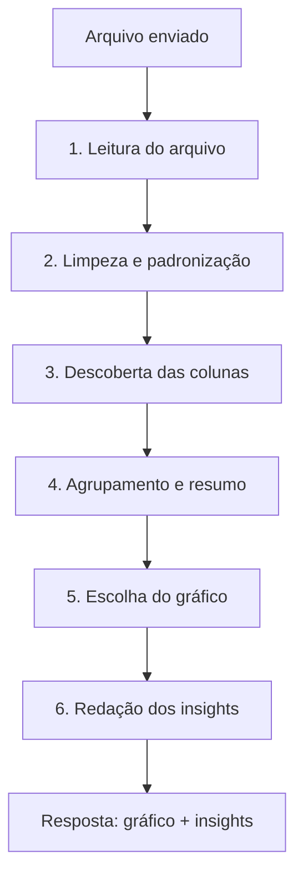

# Graf IA

> 🎓 **Projeto de estudos.** Este é um projeto pessoal criado para aprendizado e experimentação (arquitetura, integração com LLM, processamento de planilhas). Não é um produto pronto para produção e pode mudar a qualquer momento.

Uma API que lê planilhas e devolve **gráficos prontos para exibir, com insights escritos em português**.

Você envia um arquivo `.csv`, `.xlsx` ou `.xls` e a API faz o trabalho pesado: entende os dados, monta os resumos (total, média, quem lidera), sugere o melhor tipo de gráfico e escreve uma análise curta em linguagem natural. Se a análise por IA não estiver disponível, ela ainda responde com um texto padrão baseado nos números, então nunca fica sem retorno.

---

## O que ela faz hoje

- 📄 **Lê planilhas** CSV e Excel (arquivo de até 25 MB).
- 📊 **Agrupa e resume** os dados: total, média, mínimo, máximo, participação do Top 1 e do Top 3.
- 📈 **Escolhe o gráfico** mais adequado (barra, pizza, linha ou KPI) e justifica a escolha.
- 💬 **Escreve os insights** em português, prontos para mostrar na tela.
- 🗂️ **Trabalha por aba**: um Excel com várias planilhas gera um bloco de gráfico para cada uma.
- 🔎 **Aceita filtros** opcionais de período e de colunas.
- 🔒 **Protege os dados**: CPF, CNPJ e e-mails são mascarados antes de qualquer coisa ir para a IA.

---

## Como funciona (passo a passo)

Pense na API como uma linha de montagem: cada etapa entrega algo para a etapa seguinte, até o arquivo virar um gráfico com um texto explicando o que ele mostra.



**1. Leitura do arquivo.** Aceita CSV e Excel. No CSV, identifica sozinha se o separador é vírgula ou ponto e vírgula e corrige a acentuação quando o arquivo não está em UTF-8. No Excel, **cada aba é tratada como um conjunto de dados independente** (um CSV gera apenas um conjunto).

**2. Limpeza e padronização.** Nomes de colunas e valores são normalizados: espaços extras, quebras de linha, acentos e caracteres estranhos saem da jogada. Isso evita que `Região` e `Regiao` sejam tratados como colunas diferentes.

**3. Descoberta das colunas.** Para montar um gráfico, a API precisa saber qual coluna é a **dimensão** (o agrupamento, eixo X, normalmente texto) e qual é a **métrica** (o número, eixo Y, o que será somado). Ela decide assim, nesta ordem:

1. Usa os filtros que você enviou, se eles apontarem para colunas que existem.
2. Procura colunas de métrica com nomes conhecidos (ex.: `Total`, `Valor`, `Frete`).
3. Se ainda houver dúvida, analisa o conteúdo: a coluna com valores numéricos vira a métrica e, entre as de texto, escolhe a que tem uma boa variedade de categorias como dimensão.

**4. Agrupamento e resumo.** Os valores são **somados por categoria** da dimensão. A API mantém até 20 categorias — as maiores por valor ou, quando a dimensão é uma data, as 20 mais recentes em ordem cronológica. Também calcula os números de apoio: total, média, mínimo, máximo, participação do maior item (Top 1) e dos três maiores (Top 3), além do período coberto pelos dados.

**5. Escolha do gráfico.** A IA analisa esse resumo e propõe o tipo de visualização. A proposta passa por uma validação: se ela não fizer sentido para os dados — ou se a IA estiver indisponível — entram regras automáticas.

| O que os dados mostram            | Gráfico escolhido |
| --------------------------------- | ----------------- |
| Uma única categoria               | KPI               |
| Eixo X é formado por datas        | Linha             |
| Até 6 categorias bem distribuídas | Pizza             |
| Muitas categorias ou comparação   | Barras            |

**6. Redação dos insights.** Antes de qualquer informação seguir para a IA, ela passa por uma proteção que **mascara CPF, CNPJ e e-mails**. A IA então escreve **até 3 frases**, priorizando quem lidera, o nível de concentração e uma sugestão de ação (tendência e valor fora do padrão entram quando fazem sentido). Se a IA falhar, a própria API monta essas frases a partir do ranking.

**7. Montagem da resposta.** Cada conjunto de dados vira um **bloco** com título, tipo de gráfico, rótulos, os valores para plotar, os KPIs e os insights. Um Excel com várias abas gera vários blocos.

> ℹ️ O endpoint `/api/chart/recommend` é mais leve: ele **não soma nem agrupa valores**. Faz apenas a leitura e a "análise técnica" da planilha (tipos de coluna, quantos valores únicos, exemplos) e devolve a recomendação de gráfico para cada aba.

---

## Pré-requisitos

- [.NET SDK 10](https://dotnet.microsoft.com/download)
- Uma chave de API de um provedor de IA compatível com OpenAI (o padrão é a DeepSeek)

---

## Configurando a IA

As credenciais são lidas da seção `LLM` do arquivo de configuração. Como o `appsettings.json` **não vai para o repositório** (é ignorado por segurança), o caminho recomendado é usar o _user secrets_:

```bash
dotnet user-secrets init --project src/SmartIa.Api
dotnet user-secrets set "LLM:ApiKey"   "sk-..."                    --project src/SmartIa.Api
dotnet user-secrets set "LLM:ModelId"  "deepseek-chat"             --project src/SmartIa.Api
dotnet user-secrets set "LLM:Endpoint" "https://api.deepseek.com"  --project src/SmartIa.Api
```

> Se `ApiKey`, `ModelId` ou `Endpoint` ficarem vazios, a API continua funcionando — só que sem IA, usando os insights automáticos.

---

## Rodando o projeto

```bash
dotnet restore
dotnet build
dotnet run --project src/SmartIa.Api --launch-profile http
```

---

## Tecnologias

| Camada       | O que é usada              |
| ------------ | -------------------------- |
| Base         | .NET 10 / ASP.NET Core     |
| IA           | Semantic Kernel            |
| Planilhas    | CsvHelper, ExcelDataReader |
| Documentação | Swagger                    |
| Testes       | xUnit + Moq                |

O código está organizado em camadas:

```
src/
├── SmartIa.Api            # as rotas e a configuração da aplicação
├── SmartIa.Application    # as regras do negócio
└── SmartIa.Infrastructure  # leitura de arquivos, IA e proteção de dados
tests/
└── SmartIa.Tests          # testes automatizados
```
